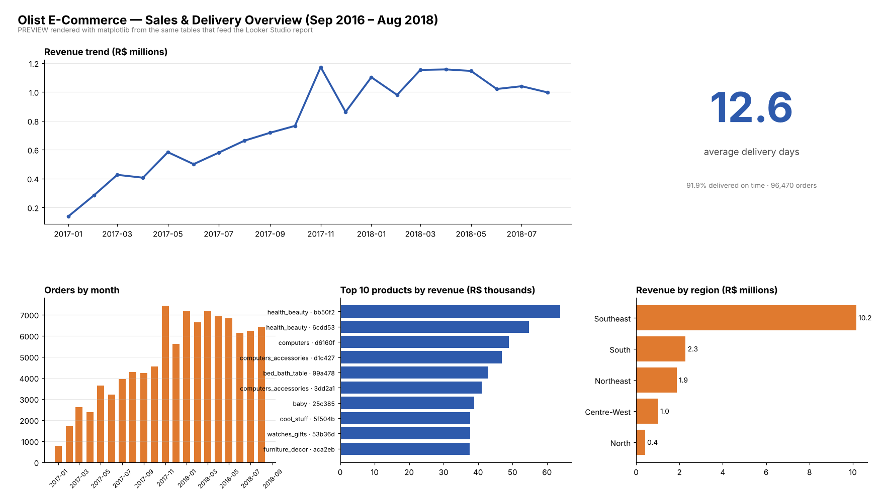

# Ecommerce Data Cleanup and Reporting

Portfolio project by **Uzair Akhtar**, using the [public Olist ecommerce dataset](https://www.kaggle.com/datasets/olistbr/brazilian-ecommerce).

I used Python and pandas to clean related CSV files, check data quality and prepare tables for sales and delivery reporting.

## Report preview

This is a static report preview created with Python and Matplotlib.

## What I did

- Profiled the source tables for duplicates, missing values, data types and join issues.
- Removed 261,831 exact duplicate rows from the geolocation table.
- Labelled 610 products with missing categories as `unknown`.
- Flagged 304 orders for payment checks, including one with a missing payment record.
- Converted timestamps and documented missing delivery dates.
- Prepared CSV exports for KPIs, monthly reporting, revenue by state and top products.

Payment flags identify records that need further investigation.

## Metric definitions

- Order revenue includes item prices plus freight. Orders marked `canceled` or `unavailable` are excluded from the order reporting table.
- Product rankings use item prices across the items table, without freight.
- Delivery time is calculated for delivered orders with usable dates.

## Explore the work

- [Cleaning notebook](olist_data_cleaning.ipynb): cleaning steps, checks and saved outputs.
- [Reporting tables](data/dashboard/): exported CSV files.
- [Table builder](src/build_dashboard_tables.py): rebuilds aggregate tables after the notebook creates the order fact table.
- [Looker Studio setup guide](docs/looker_studio_setup.md): instructions for building a Looker Studio version.

## Tools

Python, pandas, NumPy, Jupyter and Matplotlib.
